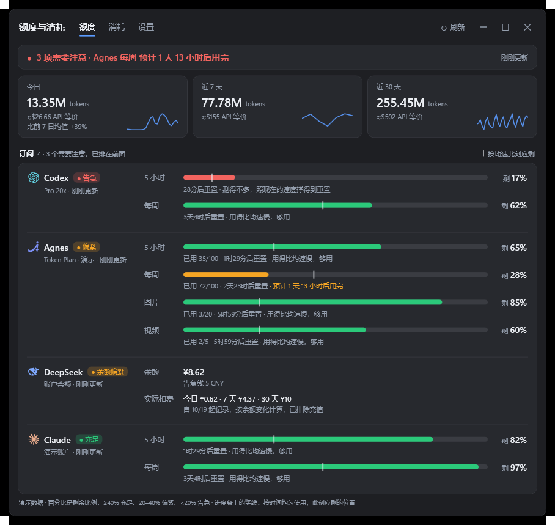

<div align="center">


# Headroom (余量)

**A Windows 11 taskbar widget for AI subscription quotas**

See how much Claude, Codex, DeepSeek and Agnes quota you have left, when it resets, and whether you will run out first at your current pace, right on the taskbar.

[Download](https://github.com/chinbor/headroom/releases/latest) · [简体中文](./README.md)



</div>

The interface is in Simplified Chinese.

## Features

- **Taskbar summary**: two lines next to the tray show the item that needs attention most (for example `Claude 5 小时 54%` and when it is expected to run out), plus a small ring per platform. Hover for a per-platform flyout; click to open the details window. Colours follow the taskbar. The summary steps aside when there is no room, the taskbar auto-hides or a full-screen app is in front.
- **Quota page**: remaining percentage, used and limit, and reset time for every window, with a marker for where an even pace would put you and a projection at the current pace.
- **Usage page**: requests, cache hit rate, output speed, a stacked daily chart, a per-platform and per-model table, a 24-hour heat strip, and DeepSeek's actual spend derived from balance changes.
- **Alerts**: a card in the corner when a window turns critical or will run out within the hour (or a system notification, or off).
- **Sign in on the web page**: for DeepSeek and Agnes, click 登录 in settings and sign in on the page that opens; the app reads the session itself.
- **Extensible**: platforms are described by JSON recipes (`platforms/*.json`), see [docs/platform-recipes.md](./docs/platform-recipes.md).

## Install

Windows 11 x64 with .NET Framework 4.8 (built in). Download `codeusagemonit-setup-<version>.exe` or the portable `codeusagemonit-<version>-win-x64.zip` from [Releases](https://github.com/chinbor/headroom/releases/latest), or run:

```powershell
irm https://raw.githubusercontent.com/chinbor/headroom/main/install.ps1 | iex
```

Run `codeusagemonit.exe --demo` to try it with made-up data. The executable and data folder keep the original name `codeusagemonit`.

## Privacy

Tokens are encrypted with Windows DPAPI and only sent to the hosts named in the platform recipe. Only token counts, request counts, timings and model names are kept; no conversation content, no telemetry.

## Build

```powershell
.\source\Windows\build.ps1 -OutputDirectory .\dist [-Installer]
```

Pushing a `v*.*.*` tag builds and publishes a release with GitHub Actions.

## Credits

Forked from [codeusagemonit](https://github.com/fanchengliu/codeusagemonit). See [THIRD-PARTY-NOTICES.md](./THIRD-PARTY-NOTICES.md). MIT licensed; not affiliated with any of the monitored services.
