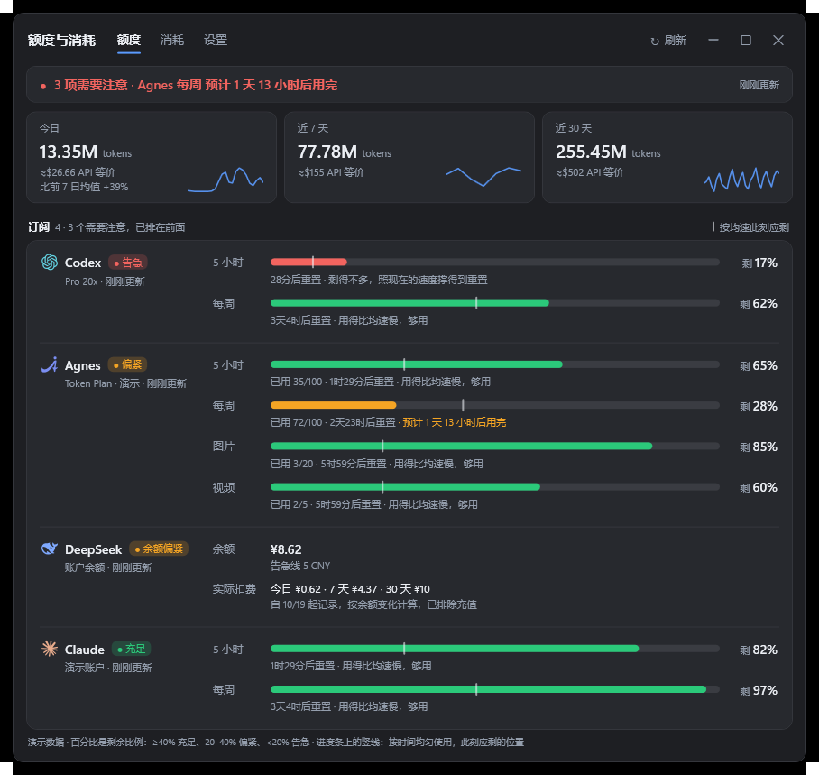

<div align="center">


# 余量 Headroom

**常驻 Windows 11 任务栏的 AI 订阅额度小组件**

Claude、Codex、DeepSeek、Agnes 还剩多少、什么时候重置、照现在的速度会不会提前用完，瞄一眼任务栏就知道。

[](https://github.com/chinbor/headroom/releases/latest)
[](./LICENSE)
[](#下载安装)

[下载](https://github.com/chinbor/headroom/releases/latest) · [使用说明](./使用说明.md) · [更新记录](./CHANGELOG.md) · [English](./README.en.md)



</div>

## 它能做什么

- **任务栏摘要**：托盘左侧的空白处用两行显示最需要关注的一项，比如 `Claude 5 小时 54%`、`预计 2时5分后用完`，旁边每个平台一个小圆环。鼠标悬停弹出各平台明细，单击打开详情窗口。颜色跟随任务栏自动换深浅；任务栏放不下、自动隐藏或前台全屏时会自动让开。
- **额度页**：每个额度窗口显示剩余百分比、已用和上限、多久后重置。进度条上的竖线标出按均速此刻应剩的位置，下面一行给出按当前速度的预计。顶部是今日、近 7 天、近 30 天的 token 和 API 等价费用。
- **消耗页**：请求数、缓存命中率、输出速度；按平台堆叠的每日柱状图；按平台和模型拆分的表格；24 小时用量热力条；DeepSeek 按余额变化记下的实际扣费。
- **提醒**：某个窗口刚变成告急，或者照当前速度 1 小时内会用完时，右下角弹出提醒卡片，也可以改成系统通知或关闭。余额告警线可调。
- **网页登录接入**：DeepSeek、Agnes 在设置里点“登录”，在弹出的页面里正常登录，程序自动读取登录信息，不用手动复制 token。
- **可扩展**：平台用 JSON 接入方案描述（`platforms/*.json`），写一段同样格式的 JSON 就能接入新平台，见 [平台接入方案](./docs/platform-recipes.md)。

## 支持的平台

| 平台 | 怎么接入 | 显示的内容 |
| --- | --- | --- |
| Claude | 复用 Claude Code 的登录 | 5 小时、每周额度；本机日志里的 token 和费用 |
| Codex | 复用 Codex 应用或 CLI 的登录 | 5 小时、每周额度；本机日志里的 token 和费用 |
| DeepSeek | 设置里点“登录”，在网页里登录；也可以只填 API Key（只读余额） | 余额、每天每个模型的 token、实际扣费 |
| Agnes | 设置里点“登录”，在网页里登录 | 文本 5 小时、每周额度，图像和视频每日额度，每天的 token |

## 下载安装

需要 Windows 11 x64。系统自带的 .NET Framework 4.8 即可运行；网页登录用系统自带的 Microsoft Edge WebView2。

从 [Releases](https://github.com/chinbor/headroom/releases/latest) 下载：

- `codeusagemonit-setup-<版本>.exe`：安装程序，不需要管理员权限，默认装到 `%LOCALAPPDATA%\Programs\codeusagemonit`，可选开机启动。
- `codeusagemonit-<版本>-win-x64.zip`：免安装，解压到任意可写的文件夹，双击 `codeusagemonit.exe`。

也可以用 PowerShell 一行安装（再运行一次即升级）：

```powershell
irm https://raw.githubusercontent.com/chinbor/headroom/main/install.ps1 | iex
```

> [!NOTE]
> 程序没有代码签名。首次运行如果提示“Windows 已保护你的电脑”，点 **更多信息 → 仍要运行**；可以用发布页的 `SHA256SUMS.txt` 核对文件。

程序文件、数据目录和安装路径沿用原项目名 `codeusagemonit`。

## 上手

1. 启动后，任务栏托盘左边会出现摘要，托盘区也有图标。单击摘要或托盘图标打开“额度与消耗”窗口，右键打开菜单。
2. Claude、Codex 在各自的客户端里登录过就能直接读到。
3. DeepSeek、Agnes：打开 设置 →“添加订阅”，点“登录添加”，在弹出的页面里登录即可。
4. 想先看效果，运行 `codeusagemonit.exe --demo`：使用演示数据，不读取账户、不联网，也不改动正式设置。

更多说明见 [使用说明](./使用说明.md)。

## 数据与隐私

- 设置和缓存在 `%LOCALAPPDATA%\codeusagemonit`（安装版）或程序旁边的 `data\`（免安装版）。
- 网页登录读到的 token 用 Windows DPAPI 加密保存，只有当前 Windows 用户能解密；只发给接入方案里写明的地址。
- 只统计 token 数、请求数、耗时和模型名，不保存对话内容；没有遥测，没有自建服务器。
- 每天从原项目仓库下载一次公开的模型价目表 `pricing.json`，可在设置里关闭。

DeepSeek、Agnes 用的是网页控制台的内部接口，没有公开文档，平台改版后可能需要更新接入方案。

## 从源码构建

只用 Windows 自带的 .NET Framework 编译器（csc）和 WPF，不需要 Visual Studio。

```powershell
git clone https://github.com/chinbor/headroom.git
cd headroom
.\source\Windows\build.ps1 -OutputDirectory .\dist        # 生成 dist\codeusagemonit.exe
Start-Process .\dist\codeusagemonit.exe --self-test -Wait  # 自测，结果在 dist\verification\tests.json
.\source\Windows\build.ps1 -OutputDirectory .\dist -Installer  # 另外生成安装包和免安装 zip
```

`-Installer` 需要 [Inno Setup 6.3 或更新版本](https://jrsoftware.org/isdl.php)。推送 `v*.*.*` 标签时，GitHub Actions 会自动构建并发布到 Releases。

源码在 [`source/Windows/`](./source/Windows/)：`TaskbarPanel.cs` 是任务栏摘要，`QuotaDashboard.cs` 是额度与消耗窗口，`SimpleSettings.cs` 是设置，`ConsoleLogin.cs` 是网页登录，`CustomProviders.cs` 解析接入方案。

## 致谢

- [codeusagemonit](https://github.com/fanchengliu/codeusagemonit)：本项目从它 Fork 而来，保留了它的本机日志统计、计价和各平台额度读取逻辑。
- [usage-dash](https://github.com/chinbor/usage-dash)：Agnes 接口流程和图标参考（MIT）。
- [CodexBar](https://github.com/steipete/CodexBar)、[ccusage](https://github.com/ccusage/ccusage)、[LiteLLM](https://github.com/BerriAI/litellm)、[models.dev](https://github.com/anomalyco/models.dev)、[Microsoft Edge WebView2](https://developer.microsoft.com/microsoft-edge/webview2/)、[Inno Setup](https://jrsoftware.org/isinfo.php)。

许可证和第三方说明见 [THIRD-PARTY-NOTICES.md](./THIRD-PARTY-NOTICES.md)。

## 许可证

[MIT](./LICENSE)。余量 Headroom 是独立的开源项目，与 Anthropic、OpenAI、DeepSeek、Agnes 等被监控的服务均无关联，产品名称和图标归各自所有者。
